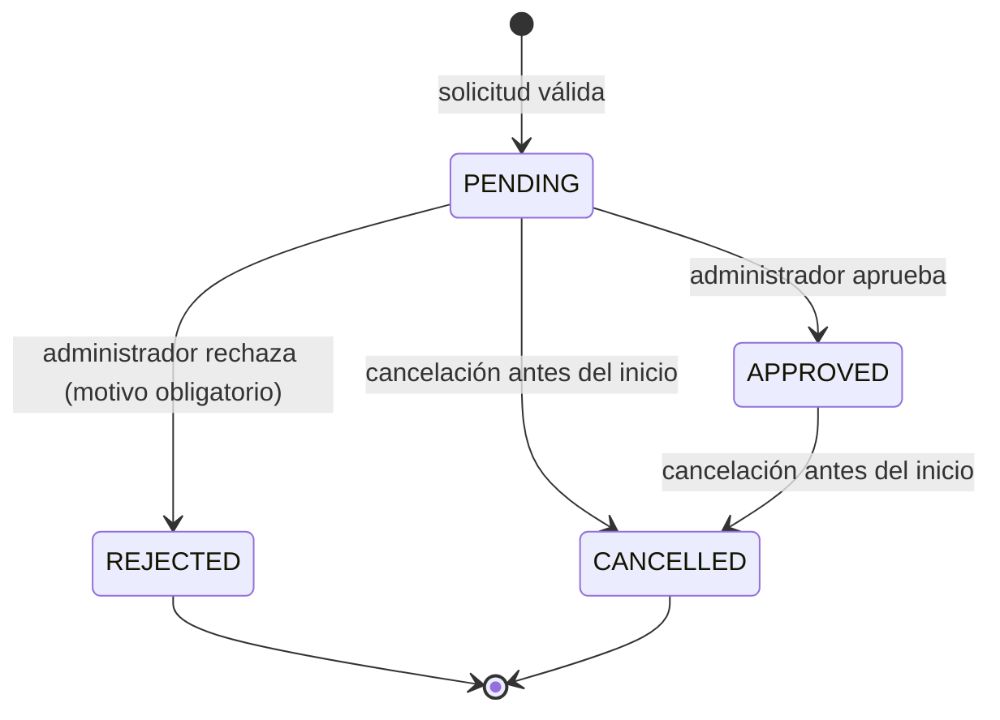
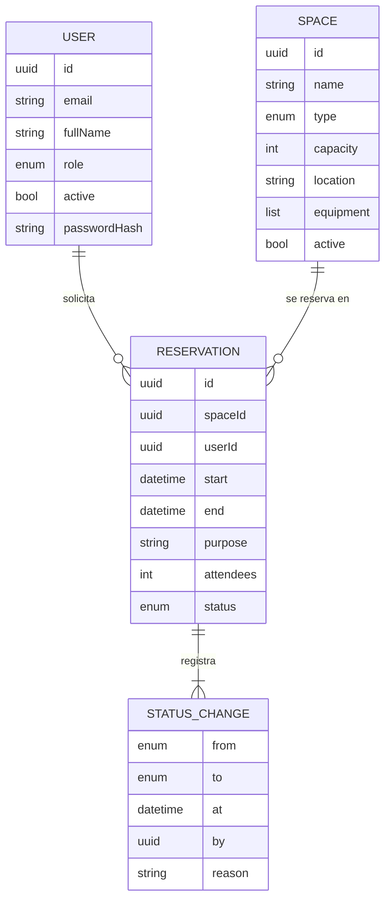
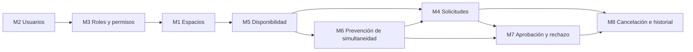

# Plan de Ingeniería de Software — Sistema de Gestión de Reservas de Espacios Académicos (UniReserve)

| Versión | Fecha | Estado |
| :--- | :--- | :--- |
| 2.0 | 2026-10-24 | Vigente. Reemplaza la versión 1.0 (commit `0bfde05`). Ver §7 *Control de cambios del plan*. |

Este documento se elabora **antes** de escribir especificaciones y código. Define qué problema se resuelve, cómo se organizará la solución, qué decisiones técnicas se toman (y por qué), cómo se asegurará la calidad y cómo se usarán OpenSpec y la inteligencia artificial.

---

## 1. Análisis del problema

### 1.1 Identificación de la problemática

La institución gestiona la reserva de laboratorios, auditorios y salas de cómputo mediante correos electrónicos y hojas de cálculo. Esto produce:

- **Duplicidad de solicitudes:** un mismo solicitante envía la misma petición por varios canales o a varias personas, y nadie consolida.
- **Conflictos de horario (doble asignación):** la hoja de cálculo no impide que dos actividades queden en el mismo espacio y franja, ni controla que dos personas la editen a la vez.
- **Consulta de disponibilidad costosa:** el solicitante depende de un administrador para saber si un espacio está libre.
- **Falta de trazabilidad:** no queda registro confiable de quién aprobó, rechazó o canceló una reserva, ni del motivo.
- **Sobrecarga administrativa:** la coordinación manual consume tiempo del personal.

### 1.2 Necesidades de la institución

| ID | Necesidad | Módulo que la atiende |
| :--- | :--- | :--- |
| N1 | Un catálogo único y actualizado de espacios reservables | M1 Gestión de espacios |
| N2 | Identificar a cada solicitante mediante una cuenta propia | M2 Usuarios |
| N3 | Controlar qué puede hacer cada tipo de usuario | M3 Roles y permisos |
| N4 | Un canal único y formal para solicitar reservas | M4 Solicitudes |
| N5 | Conocer la disponibilidad antes de solicitar | M5 Disponibilidad |
| N6 | Garantizar que un espacio no se asigne dos veces | M6 Prevención de simultaneidad |
| N7 | Una decisión administrativa explícita (aprobar o rechazar con motivo) | M7 Aprobación y rechazo |
| N8 | Cancelar reservas y consultar el historial completo | M8 Cancelación e historial |

### 1.3 Actores involucrados

| Actor | Rol en el sistema | Interés principal |
| :--- | :--- | :--- |
| **Estudiante** | `STUDENT` (solicitante) | Consultar disponibilidad, solicitar, cancelar y ver sus reservas. |
| **Profesor** | `PROFESSOR` (solicitante) | Igual que el estudiante. Se distingue para reportes y políticas futuras. |
| **Administrador de espacios** | `ADMINISTRATOR` | Mantener el catálogo, decidir solicitudes, administrar usuarios y consultar todo el historial. |
| **Sistema** | Actor no humano | Aplicar validaciones, impedir conflictos y registrar cada cambio de estado. |
| **Dirección académica** | Interesado (no usa el sistema) | Define las reglas de negocio; puede introducir reglas nuevas durante el proyecto. |

### 1.4 Alcance

- API REST (JSON) que cubre los **8 módulos** de la §2.3.
- Autenticación propia con correo y contraseña; autorización por rol.
- Flujo completo: consulta de disponibilidad → solicitud (`PENDING`) → aprobación (`APPROVED`) o rechazo (`REJECTED`) → cancelación (`CANCELLED`) → historial.
- Prevención de conflictos por espacio y por usuario, incluso con solicitudes concurrentes.

### 1.5 Limitaciones y elementos fuera de alcance

| Limitación | Justificación |
| :--- | :--- |
| Sin interfaz gráfica; se entrega una API REST consumible con Postman, curl o un frontend futuro. | El objetivo del proyecto es el proceso SDD y la lógica de negocio verificable; la UI no cambia los requisitos. |
| Persistencia en memoria en la entrega académica (los datos se pierden al reiniciar). | Ver DT-04: permite ejecutar y probar sin instalar una base de datos; la arquitectura deja lista la migración a PostgreSQL. |
| Sin notificaciones por correo. | El solicitante consulta el estado en su historial. Se deja como evolución futura. |
| Sin integración con calendarios externos ni SSO institucional. | Dependen de sistemas externos no disponibles. La capa de servicios no lo impide. |
| Sin reservas recurrentes (semestrales) ni reserva de equipos móviles. | Fuera de la necesidad planteada; aumentaría la complejidad del motor de conflictos. |
| Sin control de acceso físico. | La reserva es administrativa. |

---

## 2. Propuesta de solución

### 2.1 Descripción general

Se construirá un **backend centralizado** que reemplaza el correo y la hoja de cálculo. Todo solicitante se registra, consulta el catálogo y la disponibilidad, y crea solicitudes que el sistema valida automáticamente (fechas, capacidad, conflictos). Las solicitudes válidas quedan pendientes hasta que un administrador las aprueba o rechaza. Cada cambio de estado queda registrado con su autor, fecha y motivo.

Ciclo de vida propuesto para una reserva:



### 2.2 Funcionalidades prioritarias (MoSCoW)

| Prioridad | Funcionalidades |
| :--- | :--- |
| **Must** | Catálogo de espacios; registro, autenticación y administración de usuarios; roles y permisos; creación de solicitudes; validación de disponibilidad; prevención de reservas simultáneas; aprobación y rechazo; cancelación e historial. |
| **Should** | Búsqueda de espacios libres en una franja; bandeja de solicitudes pendientes en orden de llegada; filtros del historial. |
| **Could** | Notificaciones; reportes de ocupación. |
| **Won't (esta entrega)** | Interfaz gráfica, SSO, reservas recurrentes. |

### 2.3 Organización del sistema en módulos

Cada módulo corresponde a **una capacidad de OpenSpec**, a **una carpeta de código** y a **un archivo de pruebas**. Esta correspondencia uno a uno es la base de la trazabilidad.

| # | Módulo | Responsabilidad | Capacidad OpenSpec / carpeta `src/modules/` | Pruebas |
| :--- | :--- | :--- | :--- | :--- |
| M1 | Gestión de espacios académicos | Alta, edición, activación/desactivación y consulta del catálogo. | `space-management` | `tests/space-management.test.ts` |
| M2 | Registro y administración de usuarios | Registro, autenticación, perfil, listado y activación/desactivación de cuentas. | `user-management` | `tests/user-management.test.ts` |
| M3 | Roles y permisos | Roles, matriz de permisos, autenticación obligatoria, asignación de roles y administrador inicial. | `roles-permissions` | `tests/roles-permissions.test.ts` |
| M4 | Creación de solicitudes de reserva | Recepción y validación de solicitudes (fechas, bloques, espacio, capacidad). | `reservation-requests` | `tests/reservation-requests.test.ts` |
| M5 | Validación de disponibilidad | Definición de "disponible", consulta de ocupación y búsqueda de espacios libres. | `availability` | `tests/availability.test.ts` |
| M6 | Prevención de reservas simultáneas | Exclusividad por espacio y por usuario, duplicados y concurrencia. | `conflict-prevention` | `tests/conflict-prevention.test.ts` |
| M7 | Aprobación y rechazo de solicitudes | Bandeja de pendientes, aprobación, rechazo con motivo y transiciones válidas. | `reservation-approval` | `tests/reservation-approval.test.ts` |
| M8 | Cancelación e historial de reservas | Cancelación, registro de cambios de estado e historial del solicitante y del administrador. | `cancellation-history` | `tests/cancellation-history.test.ts` |

Los módulos se agrupan en tres subdominios: **Identidad** (M2, M3), **Catálogo** (M1) y **Reservas** (M4–M8).

### 2.4 Reglas de negocio iniciales

Estas reglas son la entrada principal para las especificaciones (ver §6.2). Cada una se convertirá en uno o más requisitos con escenarios verificables.

| ID | Regla | Módulo |
| :--- | :--- | :--- |
| RN-01 | El nombre de un espacio es único (sin distinguir mayúsculas ni espacios en los extremos). | M1 |
| RN-02 | Los espacios no se eliminan; se desactivan. Un espacio inactivo no recibe solicitudes nuevas. | M1 |
| RN-03 | El autorregistro solo permite los roles `STUDENT` o `PROFESSOR`; `ADMINISTRATOR` lo asigna otro administrador. | M2, M3 |
| RN-04 | Un administrador no puede cambiar su propio rol ni desactivar su propia cuenta (siempre existe al menos un administrador). | M3 |
| RN-05 | Las fechas se expresan en ISO-8601 **con zona horaria**; las reservas usan bloques de 30 minutos. | M4 |
| RN-06 | Solo se reserva a futuro, el fin es posterior al inicio y los asistentes no superan la capacidad. | M4 |
| RN-07 | Toda solicitud nueva queda `PENDING`. Las reservas `PENDING` y `APPROVED` ("activas") ocupan la franja: atiende primero quien solicita primero. | M4, M5 |
| RN-08 | Los intervalos son semiabiertos `[inicio, fin)`: una reserva que termina a las 12:00 no choca con otra que empieza a las 12:00. | M5 |
| RN-09 | Un espacio no puede tener dos reservas activas solapadas, y un usuario tampoco (aunque sean espacios distintos). | M6 |
| RN-10 | Solo el administrador aprueba o rechaza; el rechazo exige motivo. Solo se decide sobre solicitudes `PENDING`. | M7 |
| RN-11 | El solicitante cancela sus reservas activas antes del inicio; el administrador puede cancelar cualquiera, indicando motivo. | M8 |
| RN-12 | Cada cambio de estado se registra (estado anterior, nuevo, autor, fecha y motivo) y no se puede modificar. | M8 |

### 2.5 Estrategia para desarrollar el proyecto progresivamente

| Incremento | Contenido | Resultado demostrable |
| :--- | :--- | :--- |
| 0 — Base técnica | Proyecto TypeScript, aplicación HTTP, manejo de errores, reloj inyectable, arnés de pruebas. | `npm test` ejecuta y la app arranca. |
| 1 — Identidad | M2 Usuarios y M3 Roles y permisos. | Registro, login, perfiles y control de acceso probados. |
| 2 — Catálogo | M1 Gestión de espacios. | CRUD lógico del catálogo con filtros. |
| 3 — Motor de reservas | M4 Solicitudes, M5 Disponibilidad, M6 Prevención de simultaneidad. | Solicitudes válidas y conflictos bloqueados, incluso concurrentes. |
| 4 — Gestión y trazabilidad | M7 Aprobación/rechazo y M8 Cancelación/historial. | Ciclo de vida completo con historial auditable. |
| 5 — Cambios y cierre | Cambios solicitados por la institución (vía OpenSpec), verificación final y documentación. | Suite completa en verde, trazabilidad sin huecos. |

---

## 3. Decisiones de arquitectura y tecnología

### 3.1 Arquitectura seleccionada: monolito modular en capas

```
            ┌────────────────────────────────────────────────────────────────┐
 HTTP/JSON  │ Presentación   routers por módulo · middleware de autenticación │
 ─────────► │                y autorización · manejador de errores            │
            ├────────────────────────────────────────────────────────────────┤
            │ Negocio        servicios por módulo · máquina de estados ·      │
            │                validaciones · políticas de conflicto            │
            ├────────────────────────────────────────────────────────────────┤
            │ Datos          interfaces de repositorio · adaptador en memoria │
            │                (adaptador PostgreSQL como evolución)           │
            └────────────────────────────────────────────────────────────────┘
 Transversal: modelos de dominio · errores tipados · reloj inyectable · mutex por clave
```

**Reglas de dependencia:** la presentación solo llama a servicios; los servicios no conocen Express ni HTTP; los servicios solo acceden a datos mediante interfaces de repositorio; un *composition root* (`container`) conecta las implementaciones. Los módulos colaboran a través de sus servicios (por ejemplo, M4 usa los servicios de M5 y M6).

**Justificación:**

- **Pruebas:** la lógica de negocio se prueba con repositorios en memoria y un reloj fijo, sin red ni base de datos.
- **Sustitución de la persistencia:** cambiar a PostgreSQL implica escribir un adaptador nuevo, no modificar servicios.
- **Trazabilidad:** la división vertical (8 módulos) coincide con las capacidades de OpenSpec; la horizontal (capas) separa responsabilidades técnicas.
- **Complejidad proporcional:** un solo desplegable, sin comunicación de red entre módulos.

### 3.2 Stack tecnológico propuesto

| Componente | Elección | Justificación |
| :--- | :--- | :--- |
| Entorno de ejecución | Node.js ≥ 22.12 (LTS) | Versión LTS soportada por todas las herramientas del proyecto. |
| Lenguaje | TypeScript en modo `strict` | Los errores de tipo en fechas, estados e identificadores son críticos en reservas; se detectan antes de ejecutar. |
| Framework HTTP | Express 5 | Estándar, mínimo, con manejo nativo de errores en funciones `async`. |
| Autenticación | JWT (`jsonwebtoken`) + `bcryptjs` | Tokens firmados de corta duración; contraseñas con hash y sal. `bcryptjs` no requiere compilación nativa. |
| Pruebas | Vitest + Supertest + cobertura V8 | Ejecuta TypeScript sin configuración extra; Supertest prueba la API real sin abrir puertos. |
| Ejecución en desarrollo | `tsx` | Ejecuta TypeScript directamente, con recarga en caliente. |
| Especificaciones | OpenSpec (`@fission-ai/openspec`) | Herramienta SDD exigida; valida formato y gestiona cambios. Se instala como dependencia de desarrollo para que cualquier evaluador use la misma versión. |
| Control de versiones | Git + GitHub | Evidencia de la secuencia plan → especificación → implementación. |

### 3.3 Estrategia de persistencia de datos

**Modelo de datos:**



- **Patrón Repository** con interfaces asíncronas (`UserRepository`, `SpaceRepository`, `ReservationRepository`).
- **Entrega académica:** adaptador **en memoria** (estructuras `Map`, devolviendo copias para que nadie modifique el estado por referencia). Cero dependencias externas: cualquier evaluador ejecuta `npm install && npm test`.
- **Consistencia en la entrega:** la verificación de disponibilidad y la escritura se serializan con un **mutex por clave** (espacio y usuario), de modo que dos solicitudes concurrentes no puedan pasar ambas la validación.
- **Destino de producción:** PostgreSQL. La garantía de no solapamiento pasaría a la base de datos con una restricción de exclusión, conservando el mutex como primera barrera:

```sql
CREATE EXTENSION IF NOT EXISTS btree_gist;
CREATE TABLE reservations (
  id         uuid PRIMARY KEY,
  space_id   uuid NOT NULL REFERENCES spaces(id),
  user_id    uuid NOT NULL REFERENCES users(id),
  period     tstzrange NOT NULL,              -- intervalo semiabierto [inicio, fin)
  status     text NOT NULL CHECK (status IN ('PENDING','APPROVED','REJECTED','CANCELLED')),
  purpose    text NOT NULL,
  attendees  int  NOT NULL CHECK (attendees > 0),
  EXCLUDE USING gist (space_id WITH =, period WITH &&) WHERE (status IN ('PENDING','APPROVED'))
);
```

- **Integridad histórica:** usuarios y espacios no se eliminan físicamente (solo se desactivan) para no romper el historial de reservas.

### 3.4 Organización de componentes

```
src/
├── app.ts                 # crea la aplicación Express a partir de dependencias
├── server.ts              # arranque: configuración, administrador inicial, puerto
├── config.ts              # lectura de variables de entorno
├── container.ts           # composition root: repositorios → servicios
├── domain/                # modelos y máquina de estados de la reserva
├── shared/                # errores, validación, tiempo, reloj, mutex, middleware HTTP
├── repositories/          # interfaces + adaptador en memoria
└── modules/
    ├── space-management/      (M1)  servicio + rutas
    ├── user-management/       (M2)  servicio de usuarios, autenticación + rutas
    ├── roles-permissions/     (M3)  matriz de permisos, middleware, roles, admin inicial
    ├── reservation-requests/  (M4)
    ├── availability/          (M5)
    ├── conflict-prevention/   (M6)
    ├── reservation-approval/  (M7)
    └── cancellation-history/  (M8)
tests/                     # un archivo por capacidad + pruebas unitarias
scripts/trace.ts           # verificación automática de trazabilidad escenario → prueba
openspec/                  # configuración, especificaciones vigentes y cambios
```

### 3.5 Decisiones técnicas y alternativas descartadas

| ID | Decisión | Alternativas descartadas | Justificación |
| :--- | :--- | :--- | :--- |
| DT-01 | **Monolito modular en capas** | Microservicios; monolito sin capas (rutas con lógica y datos mezclados). | Microservicios añaden red, despliegue y consistencia distribuida sin beneficio para este tamaño. Sin capas, la lógica no se puede probar aislada ni cambiar la persistencia. |
| DT-02 | **TypeScript strict** | JavaScript. | Fechas, estados y roles tipados evitan errores silenciosos; el compilador actúa como primera revisión del código generado por IA. |
| DT-03 | **Express 5** | NestJS; Fastify. | NestJS impone decoradores e inyección propios que ocultan la arquitectura que se quiere demostrar. Fastify es más rápido, pero el rendimiento no es un requisito y Express es más conocido. |
| DT-04 | **Repositorio en memoria (entrega) + PostgreSQL como destino** | PostgreSQL desde el inicio; MongoDB; SQLite. | Una base de datos obligatoria complica la ejecución por evaluadores sin aportar requisitos verificables. MongoDB no ofrece restricciones de exclusión de intervalos. SQLite no tiene `tstzrange` ni restricciones de exclusión. |
| DT-05 | **JWT de corta duración + consulta del usuario en cada petición** | Sesiones en servidor; JWT puro (confiar en el rol del token). | El JWT puro mantendría permisos obsoletos tras un cambio de rol o una desactivación. Las sesiones requieren almacén compartido. La consulta por petición es barata y aplica los cambios de inmediato. |
| DT-06 | **Mutex por clave (espacio, usuario) en la capa de negocio** | No controlar la concurrencia (confiar en el event loop); bloqueo optimista con versión. | En cuanto el repositorio haga E/S real, dos peticiones pueden intercalarse entre la verificación y la escritura. El bloqueo optimista requiere reintentos y no expresa "intervalo libre". El mutex es simple y verificable con pruebas de concurrencia. |
| DT-07 | **Vitest + Supertest** | Jest + ts-jest; script manual con `console.log` (iteración 1). | Vitest ejecuta TypeScript sin compilador adicional y es compatible con la API de Jest. Un script manual no aísla casos, no reporta cobertura y se detiene en el primer fallo. |
| DT-08 | **`PENDING` ocupa la franja (primero en llegar, primero en ser atendido)** | Solo `APPROVED` ocupa la franja (iteración 1). | Si solo `APPROVED` bloquea, dos solicitudes pendientes del mismo horario pueden aprobarse ambas (doble reserva) y reaparece la duplicidad que se quiere eliminar. |
| DT-09 | **Intervalos semiabiertos `[inicio, fin)` y bloques de 30 minutos** | Intervalos cerrados; minutos libres. | Con intervalos cerrados, dos clases consecutivas (10–12 y 12–14) "chocarían". Los bloques de 30 minutos normalizan las franjas y simplifican la consulta de ocupación. |

---

## 4. Estrategia de desarrollo

### 4.1 Metodología de trabajo

**Spec-Driven Development (SDD) con OpenSpec**, en incrementos cortos. Ninguna funcionalidad se implementa sin un requisito revisado. Cada cambio sigue el ciclo:

1. **Proponer** (`openspec new change`): `proposal.md` (por qué y qué), especificaciones delta (`ADDED`/`MODIFIED`/`REMOVED`), `design.md` (cómo) y `tasks.md` (pasos verificables).
2. **Revisar**: checklist de la §5.3; `openspec validate --strict`; registro en `review.md`.
3. **Implementar**: tareas en orden, con la IA como asistente; commit por incremento.
4. **Verificar**: `npm run verify` (tipos, especificaciones, pruebas con cobertura, trazabilidad).
5. **Archivar** (`openspec archive`): las especificaciones delta pasan a `openspec/specs/`.

### 4.2 Etapas de implementación

| Etapa | Entregable | Commit(s) |
| :--- | :--- | :--- |
| 1. Planificación | Este documento | Independiente |
| 2.1 Especificación | Cambio OpenSpec con las 8 capacidades | Independiente |
| 2.2 Revisión | `review.md`, correcciones, `tasks.md` definitivo | Independiente |
| 2.3 Implementación | Incrementos 0–4 de la §2.5 | Uno por incremento |
| 2.4 Gestión de cambios | Cambio OpenSpec por cada nueva regla institucional: especificación → código → archivo | Especificación separada del código |
| 2.5 Verificación y cierre | Matriz de trazabilidad, `README.md`, `INFORME_FINAL.md` | Final |

### 4.3 Orden de desarrollo y dependencias entre componentes



| Módulo | Depende de | Motivo |
| :--- | :--- | :--- |
| M3 Roles | M2 | Los permisos se aplican a usuarios autenticados. |
| M1 Espacios | M3 | La gestión del catálogo es exclusiva del administrador. |
| M5 Disponibilidad | M1 | "Disponible" exige que el espacio exista y esté activo. |
| M6 Simultaneidad | M5 | Extiende la definición de disponibilidad con exclusividad y concurrencia. |
| M4 Solicitudes | M1, M5, M6 | Una solicitud se acepta solo si pasa todas las validaciones. |
| M7 Aprobación | M4, M6 | Decide sobre solicitudes existentes y revalida conflictos. |
| M8 Cancelación/historial | M4, M7 | Registra y consulta todas las transiciones de estado. |

### 4.4 Criterios para considerar terminada cada etapa (Definition of Done)

- **Planificación:** las seis secciones están completas y cada decisión tiene alternativa y justificación; commit independiente.
- **Especificación:** cada capacidad tiene propósito, requisitos con `SHALL`/`MUST` y al menos un escenario `WHEN/THEN` con valores concretos; `openspec validate --strict` sin errores.
- **Revisión:** checklist aplicado, ambigüedades y contradicciones resueltas y registradas; tareas definidas con su forma de verificación.
- **Incremento:** tareas marcadas en `tasks.md`; cada escenario del incremento tiene una prueba con el mismo nombre y pasa; `tsc` sin errores; suite completa en verde (sin regresiones); commit.
- **Cambio:** propuesta con análisis de impacto; especificación delta validada **antes** del código; pruebas nuevas y suite completa en verde; cambio archivado.
- **Cierre:** `npm run verify` en verde; cobertura de líneas ≥ 85 %; matriz de trazabilidad sin escenarios sin prueba; documentación consolidada.

---

## 5. Estrategia de calidad

### 5.1 Tipos de pruebas

| Tipo | Objetivo | Herramienta / forma |
| :--- | :--- | :--- |
| **Unitarias** | Funciones puras: solapamiento, alineación a bloques, máquina de estados; mutex. | Vitest |
| **Aceptación (integración HTTP)** | Cada escenario de OpenSpec es una prueba **con el mismo nombre**, ejecutada contra la API real con repositorios en memoria y reloj fijo. | Vitest + Supertest |
| **Concurrencia** | Solicitudes simultáneas sobre la misma franja: exactamente una gana. Se usa un repositorio con latencia artificial para forzar el intercalado. | Vitest |
| **Regresión** | La suite completa se ejecuta en cada incremento y cambio. | `npm test` |
| **Estáticas** | Tipos estrictos y formato de especificaciones. | `tsc --noEmit`, `openspec validate --strict` |
| **Trazabilidad** | Falla si algún escenario de las especificaciones no tiene prueba. | `npm run trace` |

### 5.2 Riesgos y estrategias de mitigación

| ID | Riesgo | Prob. | Impacto | Mitigación | Verificación |
| :--- | :--- | :--- | :--- | :--- | :--- |
| R1 | Doble reserva por solicitudes concurrentes o por aprobar dos pendientes solapadas. | Alta | Alto | DT-06 (mutex), DT-08 (`PENDING` bloquea), revalidación al aprobar; restricción de exclusión en producción. | Pruebas de concurrencia y de revalidación. |
| R2 | La IA implementa funcionalidad no especificada o incorrecta. | Media | Alto | Especificaciones revisadas antes del código; cada tarea cita su requisito; revisión humana del diff; pruebas por escenario. | Trazabilidad automática; checklist §6.4. |
| R3 | Requisitos ambiguos (zona horaria, reservas contiguas, quién puede cancelar). | Alta | Medio | Revisión formal de especificaciones; escenarios con valores concretos. | `review.md` con hallazgos y resoluciones. |
| R4 | Escalamiento de privilegios (autorregistro como administrador, permisos obsoletos en el token). | Media | Alto | RN-03; rol leído del almacén en cada petición (DT-05); secreto JWT por variable de entorno. | Pruebas de roles y permisos. |
| R5 | Pérdida de datos por persistencia en memoria. | Alta | Medio | Limitación documentada; patrón Repository para migrar a PostgreSQL sin tocar servicios. | Revisión de arquitectura. |
| R6 | Un cambio de reglas de negocio tardío rompe funcionalidades existentes. | Media | Medio | Gestión por cambio de OpenSpec; reglas aisladas en políticas; suite de regresión. | Suite completa en verde tras cada cambio. |
| R7 | Errores de fecha y zona horaria. | Media | Medio | ISO-8601 con zona obligatoria; instantes absolutos; reloj inyectable. | Escenarios de fechas sin zona y en el pasado. |
| R8 | Exposición de credenciales en el repositorio. | Media | Alto | `.gitignore` para `.env` y credenciales; secretos solo por entorno. | Revisión antes de cada commit. |

### 5.3 Mecanismos para verificar el cumplimiento de requisitos

1. **Matriz de trazabilidad** requisito → escenario → prueba → módulo, generada por `scripts/trace.ts` a partir de las especificaciones y las pruebas; falla si falta alguna prueba.
2. **`npm run verify`** como puerta de calidad: tipos + especificaciones + pruebas con cobertura + trazabilidad.
3. **Checklist de revisión de especificaciones:** ¿cada requisito usa `SHALL`/`MUST` y es observable? ¿Cada escenario tiene valores concretos y un resultado verificable (código HTTP, código de error, estado)? ¿Hay contradicciones entre capacidades? ¿Cada regla de la §2.4 está cubierta?
4. **Checklist de revisión de código** (§6.4).

---

## 6. Uso de SDD e inteligencia artificial

### 6.1 ¿Cómo se utilizará OpenSpec?

- `openspec init --tools claude --language es`: crea `openspec/config.yaml` y los comandos del agente (`/opsx:propose`, `/opsx:apply`, `/opsx:archive`).
- Un **cambio** por unidad de alcance: `add-core-reservation-system` para los 8 módulos y un cambio adicional por cada regla que solicite la institución.
- Artefactos de cada cambio: `proposal.md`, `specs/<capacidad>/spec.md` (delta), `design.md`, `tasks.md` y `review.md`.
- `openspec validate --strict` como compuerta antes de implementar; `openspec archive` para consolidar las especificaciones vigentes en `openspec/specs/`.

### 6.2 ¿Cómo se transformará el plan en especificaciones?

| Elemento del plan | Se convierte en |
| :--- | :--- |
| Necesidades N1–N8 y módulos M1–M8 (§1.2, §2.3) | Una **capacidad** (spec) por módulo, con su `Purpose`. |
| Reglas de negocio RN-01…RN-12 (§2.4) | **Requisitos** `SHALL`/`MUST`; al menos un escenario de éxito y uno de fallo por regla. |
| Actores y permisos (§1.3) | Requisitos de `roles-permissions` y escenarios de acceso denegado. |
| Riesgos (§5.2) | Requisitos y escenarios explícitos (concurrencia, autorregistro, fechas sin zona). |
| Arquitectura y decisiones (§3) | `design.md` del cambio. |
| Incrementos y dependencias (§2.5, §4.3) | `tasks.md`, agrupado por incremento y en orden de dependencias. |

### 6.3 ¿Qué actividades se delegarán a la IA?

Se usa un agente de programación (Claude Code) para:

- Redactar borradores de especificaciones a partir de este plan.
- Generar el código de cada módulo siguiendo `tasks.md` y las especificaciones.
- Generar pruebas a partir de los escenarios (una prueba por escenario, con el mismo nombre).
- Ejecutar validaciones y pruebas, detectar inconsistencias entre especificación y código y redactar documentación.

### 6.4 ¿Cómo se verificará el código generado?

1. Cada commit corresponde a tareas concretas de `tasks.md`.
2. No se aceptan endpoints, campos ni reglas que no estén en una especificación (revisión del diff contra la spec).
3. `tsc` estricto sin errores.
4. Las pruebas del escenario pasan **y fallan si se elimina la regla** (mutación manual de reglas críticas: solapamiento, mutex, permisos).
5. Revisión de seguridad: autorización en cada ruta, ausencia de secretos, contraseñas nunca expuestas.
6. Suite completa y trazabilidad en verde antes de cerrar cada incremento.

### 6.5 Decisiones bajo responsabilidad del estudiante

- Alcance, limitaciones y arquitectura (§1, §3).
- Reglas de negocio e interpretación de requisitos ambiguos (§2.4), por ejemplo que `PENDING` ocupe la franja o los bloques de 30 minutos.
- Aprobación de las especificaciones y de cada incremento de código.
- Decisiones de seguridad (roles, secretos, exposición de datos).
- Análisis de impacto de los cambios solicitados por la institución.
- Sustentación técnica del sistema y del proceso.

---

## 7. Control de cambios del plan

| Versión | Cambio | Motivo |
| :--- | :--- | :--- |
| 1.0 | Versión inicial: arquitectura en capas, PostgreSQL, 4 módulos (identidad, catálogo, reservas, notificaciones). | — |
| 2.0 | Los 8 módulos exigidos quedan explícitos y alineados 1:1 con capacidades, carpetas y pruebas. | La v1 agrupaba funcionalidades y no permitía rastrear cada una. |
| 2.0 | Se retira el módulo de notificaciones del alcance. | No es requisito mínimo; el estado se consulta en el historial. |
| 2.0 | Persistencia: repositorio en memoria en la entrega y PostgreSQL como destino documentado (DT-04). | Ejecución sin infraestructura; la v1 prometía PostgreSQL pero la iteración 1 no lo implementó. |
| 2.0 | Nuevas reglas RN-03, RN-04, RN-05, RN-07, RN-08, RN-09, RN-12 y decisiones DT-05 a DT-09. | La revisión de la iteración 1 encontró: doble reserva posible (solo `APPROVED` bloqueaba y la aprobación no revalidaba), autorregistro como administrador, secreto JWT fijo en el código, especificaciones fuera del formato OpenSpec, pruebas sin framework y funcionalidades faltantes (rechazo, cancelación, historial, administración de usuarios). |
| 2.0 | Estrategia de calidad con trazabilidad automatizada y `npm run verify`. | Hacer verificable el cumplimiento de requisitos. |
